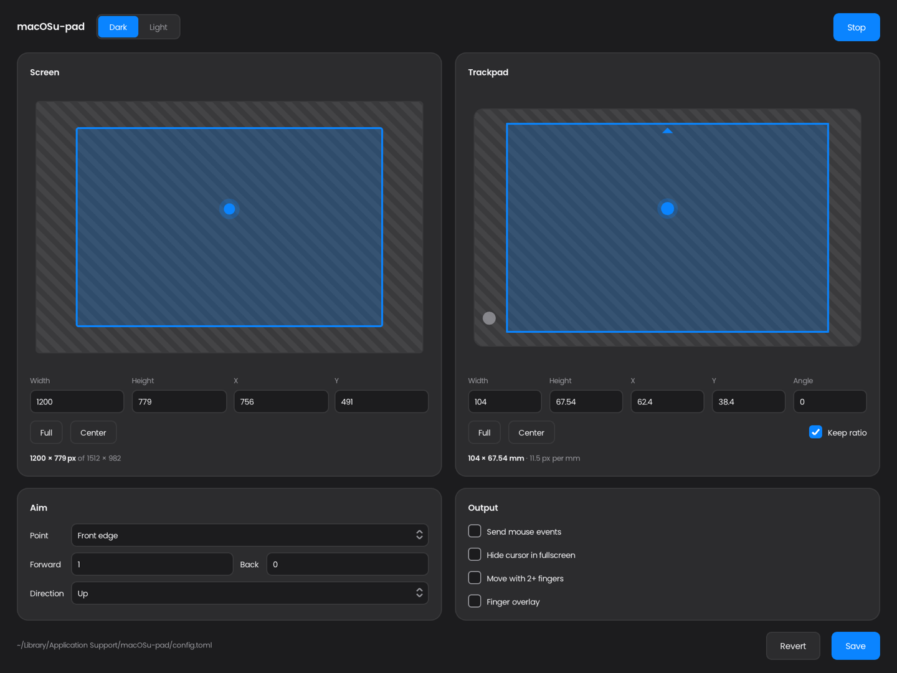
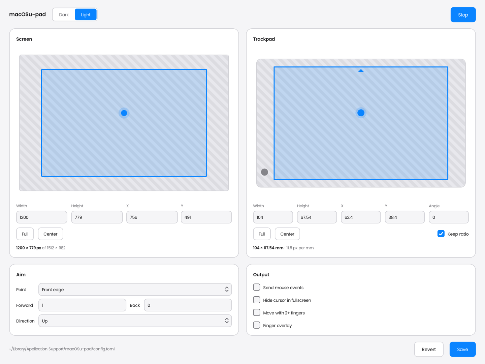

# macOSu-pad

Use your Mac trackpad like a tablet. 

<p align="center">
  
  
</p>

## Install

Download `macOSu-pad-<version>.dmg` from the Releases page, open it and drag
macOSu-pad onto Applications.

> [!TIP]
> If macOS says it can't check the app, open it once, then click **Open Anyway**
> in *System Settings -> Privacy & Security*.

## How it works

A normal trackpad uses relative positioning. macOSu-pad turns it into an absolute positioning device, mapping your finger's position directly to the screen, much like a drawing tablet.

It uses Apple's private MultitouchSupport framework to read raw touch data at ~125Hz, including finger position, size, angle, and contact state.

A ~20ms delay filters accidental touches, while multi-finger gestures are ignored until the fingers lift, preventing scrolling and swiping from moving the cursor. Fingertip correction compensates for the difference between the touch center and where you're actually aiming, with the touch size averaged over about a second to prevent pressure-related cursor shifts.

Touch coordinates are rotated, clamped, and scaled from a configurable trackpad region to a screen region. The cursor is then moved using either CGWarpMouseCursorPosition or real mouse-moved events for games like osu!. An event tap suppresses native relative movement and keeps clicks aligned with the absolute position.

Everything runs directly on the multitouch thread at the hardware frame rate, with zero per-frame allocations. Processing takes around 1µs per frame, plus a few dozen microseconds to post an event. The settings window and finger overlay only receive updates when open.

> [!TIP]
> Send mouse events and Hide cursor need **Accessibility** permission. macOS asks
> for it when you start tracking: allow macOSu-pad in *System Settings -> Privacy
> & Security -> Accessibility*.

## Build

Needs macOS 15 or newer (Apple Silicon or Intel) and:

- Clang 23, CMake, Ninja and pkg-config: `brew install llvm@23 cmake ninja pkgconf`
- the Xcode Command Line Tools: `xcode-select --install`
- vcpkg:

  ```sh
  git clone https://github.com/microsoft/vcpkg ~/vcpkg
  ~/vcpkg/bootstrap-vcpkg.sh -disableMetrics
  export VCPKG_ROOT=~/vcpkg    # put this in ~/.zprofile
  ```

Then:

```sh
scripts/build             # app + disk image: build/release/macOSu-pad-<version>.dmg
scripts/build --install   # ...and copy the app to /Applications

cmake --preset debug && cmake --build --preset debug && ctest --preset debug   # development build + tests
```

## License

This project is under MIT licensing, see [LICENSE](LICENSE).